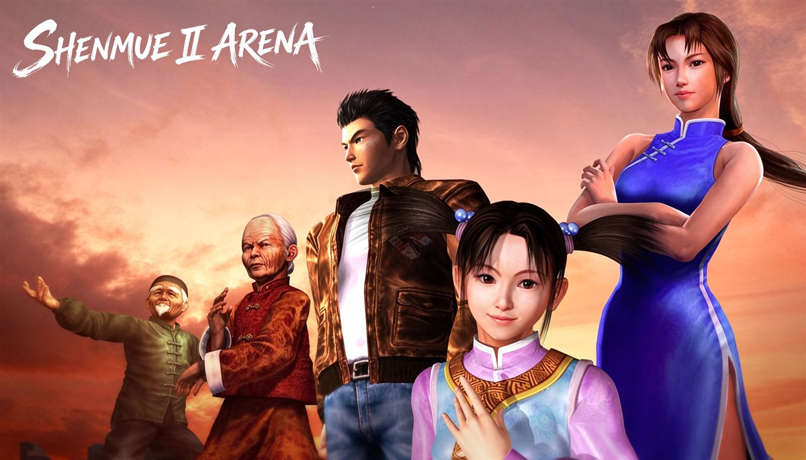

# 莎木 DC — 格斗风格与动作格式笔记

[English](README.md) | 中文说明

作者 **FibrizoReturns** · B站：[@FibrizoReturns](https://space.bilibili.com/247952238)

关于 Dreamcast 版《莎木》引擎如何存储与播放格斗风格，以及这些风格所引用的逐骨骼动作通道系统的逆向笔记。

> **仅笔记。** 本仓库不包含任何游戏数据、镜像、补丁或提取素材。下文所有描述均默认你拥有该游戏的合法副本。

## 概述

在 Dreamcast 版中，每一个格斗风格都是一个独立文件 `EN_<NAME>.BIN`，存放在 `PAKS` 归档包里。文件结构是一个短小的头部加上五个各自独立寻址的段。搞清楚每一段到底在干什么，是修改招式、在角色之间互换风格、或跨代移植动作的前提。

## 文档

| # | 文档 | 内容 |
|---|---|---|
| 01 | [EN 文件格式](docs/01-en-file-format.md) | 头部布局、五个段、每一段究竟是什么 |
| 02 | [动作通道](docs/02-motion-channels-69.md) | 69 通道逐帧姿态系统及其骨骼映射 |
| 03 | [PKS 重打包](docs/03-pks-repack.md) | `PAKS` 容器结构，以及那些会把包搞坏的错误做法 |
| 04 | [外部参考索引](docs/04-external-references.md) | 这些笔记依赖的公开研究，以及每份资料所处的结构层 |

## 主要结论

- 风格文件的头部是五个偏移量组成的表。段 0 是**反应程序** —— 一段字节码流，真正的招式 ID 存在这里。
- 段 4 **不是**招式表。它按状态索引受击、倒地、防御、起身的动画 ID。把它当招式表改不会有任何变化。
- 一个招式由操作码 `5` 加一个 32 位值编码，该值的低 12 位就是动作 ID。
- 69 通道格式通过直接旋转、IK 目标和继承通道三种方式驱动骨架。通道 45–56 是右臂，57–68 是左臂，9–26 是双腿，27–44 是躯干与头部。
- `PAKS` 归档包在文件末尾维护一张每条 20 字节的目录表，查表用的是二分查找加 8 字节名字精确比对。改动条目数量或顺序却没有正确重建目录表，引擎会静默回退到默认风格。

## 视频演示

这套研究实际落地的演示 —— 莎木2 格斗模式，角色与招式做了替换：

https://www.bilibili.com/video/BV1T5yVzjEj6/

视频仅为 Mod 演示，不附带任何游戏文件。

## 相关工作

容器、模型与贴图格式在别处已经有很完整的整理：

- [new-yokosuka/SHENMUE_DOCUMENTATION](https://github.com/new-yokosuka/SHENMUE_DOCUMENTATION) — `PAKS`/`PAKF`、`MT5`/`HRCM`、`PVR` 贴图
- [brynnb/ghidra-dreamcast-shenmue](https://github.com/brynnb/ghidra-dreamcast-shenmue) — Ghidra 加载器与过场 `SEQ` 研究
- [Shenmue-Mods/Knowledgebase](https://github.com/Shenmue-Mods/Knowledgebase) — 容器、贴图、文本与角色 ID 参考资料（见 [04](docs/04-external-references.md)）

两者聚焦于容器与模型层。本仓库补上的是 `EN_*.BIN` 本身的布局 —— 五个段各自是什么、招式如何编码，以及为什么 `PAKS` 目录表没建好时引擎会静默退回默认风格。

## 许可

MIT。
